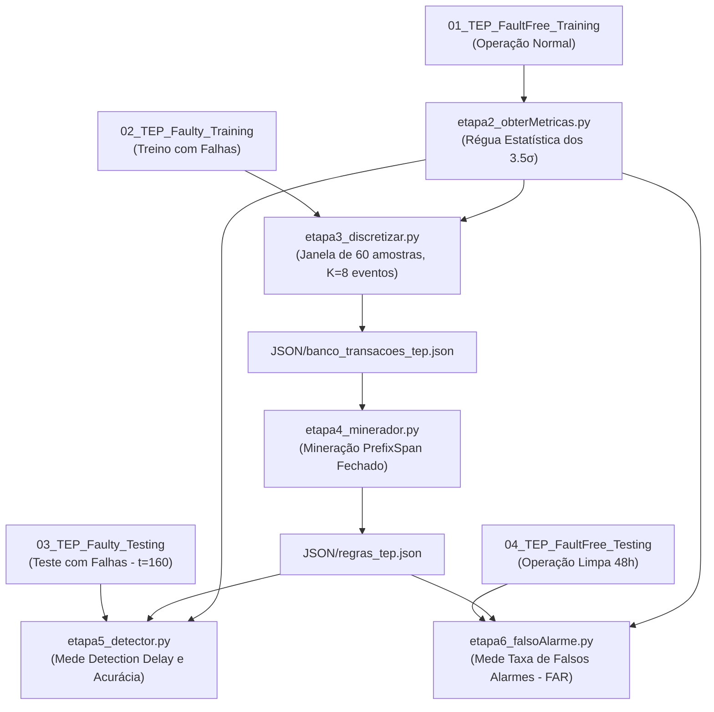

# Detecção e Diagnóstico de Falhas no Processo Tennessee Eastman (TEP) utilizando Mineração de Padrões Sequenciais (PrefixSpan)

Este repositório contém a implementação completa do Trabalho de Conclusão de Curso (TCC) focado em **Detecção Precoce de Falhas Industriais** (*Early Fault Detection and Diagnosis*) através da extração de assinaturas temporais com o algoritmo **PrefixSpan**, aplicado sobre o processo químico de referência **Tennessee Eastman Process (TEP)**.

---

## 📌 Visão Geral e Metodologia

O fluxo metodológico do projeto é composto por 6 etapas sequenciais, mapeadas diretamente sobre os 4 conjuntos de dados oficiais do benchmark TEP:



---

## 📂 Estrutura de Diretórios

```text
TCC/
│
├── Docs/
│   └── TEP + PREFIXSPAN.pdf           # Diretrizes metodológicas do TCC
│
├── SRC/
│   ├── JSON/                          # Arquivos de dados e regras intermediárias
│   │   ├── banco_transacoes_tep.json  # Transações sequenciais geradas (K=8 eventos)
│   │   └── regras_tep.json            # Padrões frequentes minerados pelo PrefixSpan
│   │
│   ├── TEP/                           # Datasets brutos e convertidos (.parquet e .RData)
│   │   ├── 01_TEP_FaultFree_Training.{parquet, RData}
│   │   ├── 02_TEP_Faulty_Training.{parquet, RData}
│   │   ├── 03_TEP_Faulty_Testing.{parquet, RData}
│   │   └── 04_TEP_FaultFree_Testing.{parquet, RData}
│   │
│   ├── etapa1_conversor.py            # Conversão de arquivos .RData para .parquet
│   ├── etapa2_obterMetricas.py        # Cálculo da média (µ) e desvio padrão (σ)
│   ├── etapa3_discretizar.py          # Discretização e extração dos primeiros K eventos
│   ├── etapa4_minerador.py            # Mineração de padrões fechados com PrefixSpan
│   ├── etapa5_detector.py             # Simulação em tempo real e cálculo do Detection Delay
│   └── etapa6_falsoAlarme.py          # Validação de imunidade a falsos positivos (FAR)
│
├── main.py                            # Ponto de entrada / menu interativo
├── pyproject.toml                     # Configuração de dependências (uv / pip)
├── uv.lock
└── README.md
```

---

## ⚙️ Pré-requisitos e Instalação

O projeto requer **Python >= 3.13** e gerencia suas dependências preferencialmente com o [uv](https://github.com/astral-sh/uv).

### 1. Clonar o repositório e acessar o diretório
```bash
git clone <url-do-repositorio>
cd TCC
```

### 2. Instalar as dependências via `uv`
```bash
uv sync
```
*(Ou via `pip install pandas prefixspan pyarrow pyreadr`)*

---

## 🚀 Como Executar o Pipeline

Navegue até o diretório `SRC/` com o ambiente virtual ativo:

```powershell
cd SRC
```

### Passo 1: Conversão dos Dados (Executado uma única vez)
Converte os arquivos `.RData` brutos para Apache Parquet para acelerar a leitura:
```powershell
py .\etapa1_conversor.py
```

### Passo 2: Régua Estatística
Calcula média e desvio padrão dos 52 sensores no regime sem falhas ($\mu \pm 3.5\sigma$). É consumido automaticamente pelas etapas seguintes:
```powershell
py .\etapa2_obterMetricas.py
```

### Passo 3: Discretização de Treino (First-K Events)
Filtra a janela pós-falha (amostras 21 a 81), discretiza desvios em eventos (`_ALTO` e `_BAIXO`) e retém apenas os **primeiros 8 eventos únicos** de cada simulação:
```powershell
py .\etapa3_discretizar.py
```
*Gera o arquivo: `JSON/banco_transacoes_tep.json`*

### Passo 4: Mineração de Padrões Sequenciais
Aplica o algoritmo **PrefixSpan** para extrair padrões frequentes fechados (`closed=True`) com suporte mínimo de 50%:
```powershell
py .\etapa4_minerador.py
```
*Gera o arquivo: `JSON/regras_tep.json`*

### Passo 5: Detecção Online e Detection Delay
Simula o monitoramento em tempo real no conjunto de teste independente (`03_TEP_Faulty_Testing.parquet`), medindo o atraso de detecção a partir da amostra 160:
```powershell
py .\etapa5_detector.py
```

### Passo 6: Avaliação de Falsos Alarmes (FAR)
Processa as 48 horas de simulação limpa (`04_TEP_FaultFree_Testing.parquet`) para medir a taxa de falsos positivos:
```powershell
py .\etapa6_falsoAlarme.py
```

---

## 📊 Tabela Oficial de Resultados (Detection Delay)

Resultados obtidos na avaliação de **500 corridas de simulação independentes** para cada falha no conjunto de teste:

| Falha | Descrição Física no TEP | Detecções no Teste | Taxa de Acerto (%) | Atraso Médio (*Detection Delay*) | Tempo Médio de Resposta |
| :---: | :--- | :---: | :---: | :---: | :---: |
| **Falha 4** | Degrau na temperatura da água de resfriamento do reator | 500 / 500 | **100.0%** | **1.0 amostra** | **3 minutos** (Instantânea) |
| **Falha 6** | Perda na alimentação do reagente A (Degrau) | 500 / 500 | **100.0%** | **1.0 amostra** | **3 minutos** (Instantânea) |
| **Falha 7** | Perda de pressão no cabeçote de C (Degrau) | 500 / 500 | **100.0%** | **1.0 amostra** | **3 minutos** (Instantânea) |
| **Falha 14** | Válvula de água de resfriamento do reator emperrada | 500 / 500 | **100.0%** | **2.3 amostras** | **~7 minutos** |
| **Falha 1** | Degrau na razão de alimentação A/C | 500 / 500 | **100.0%** | **7.5 amostras** | **~22 minutos** |
| **Falha 5** | Degrau na temperatura da água do condensador | 500 / 500 | **100.0%** | **7.9 amostras** | **~24 minutos** |
| **Falha 2** | Degrau na composição de B | 500 / 500 | **100.0%** | **13.1 amostras** | **~39 minutos** |
| **Falha 11** | Variação aleatória na temperatura da água do reator | 500 / 500 | **100.0%** | **14.5 amostras** | **~43 minutos** |
| **Falha 19** | Variação aleatória desconhecida | 499 / 500 | **99.8%** | **19.3 amostras** | **~58 minutos** |
| **Falha 17** | Variação desconhecida | 431 / 500 | **86.2%** | **35.0 amostras** | **~105 minutos** |
| **Falha 20** | Variação desconhecida | 365 / 500 | **73.0%** | **42.0 amostras** | **~126 minutos** |

> *Nota: No benchmark TEP, cada amostra temporal equivale a um intervalo de amostragem de 3 minutos de processo.*

---

## 🔬 Discussão Técnica e Solução de Desafios

### 1. Solução da Explosão Combinatória do PrefixSpan
No início dos experimentos, falhas com dinâmicas severas (como a Falha 5) geravam **mais de 27.000 padrões** devido a transações longas (mais de 40 sensores disparando em cascata). A abordagem implementada no [etapa3_discretizar.py](file:///C:/Users/minna/Music/TCC/SRC/etapa3_discretizar.py) limitou a coleta aos **primeiros 8 eventos de cada simulação** (*First-K Events*). Isso reduziu a base de regras da Falha 5 para **apenas 8 padrões essenciais**, mantendo **100% de detecção no conjunto de teste independente**.

### 2. O Efeito do Jitter de Medição
O ruído gaussiano adicionado às variáveis do TEP faz com que sensores com dinâmicas semelhantes permutem sua ordem de disparo entre corridas diferentes. Por isso, regras concisas de 2 a 4 eventos provaram ser muito superiores a regras longas: possuem alta resiliência a ruídos e disparam com menor tempo de atraso na sala de controle.

---

## 📚 Referências Bibliográficas

1. **Downs, J. J., & Vogel, E. F. (1993).** *A plant-wide industrial process control problem.* Computers & Chemical Engineering, 17(3), 245-255.
2. **Pei, J., Han, J., Mortazavi-Asl, B., Wang, J., Pinto, H., Chen, Q., Dayal, U., & Hsu, M. C. (2004).** *Mining sequential patterns by pattern-growth: The PrefixSpan approach.* IEEE Transactions on Knowledge and Data Engineering, 16(11), 1424-1440.
3. **Yin, S., Ding, S. X., Haghani, A., Hao, H., & Zhang, P. (2012).** *A comparison study on basic data-driven fault diagnosis and process monitoring methods on the benchmark Tennessee Eastman process.* Journal of Process Control, 22(9), 1567-1581.
4. **Rieth, C. A., Amsel, B. D., Tran, R., & Maia, M. B. (2017).** *Additional Tennessee Eastman Process Simulation Data for Anomaly Detection Evaluation.* Harvard Dataverse.

